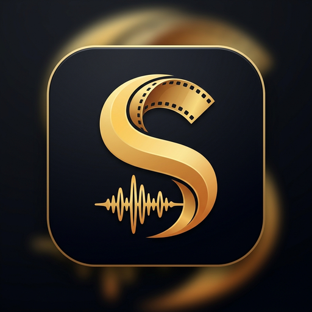
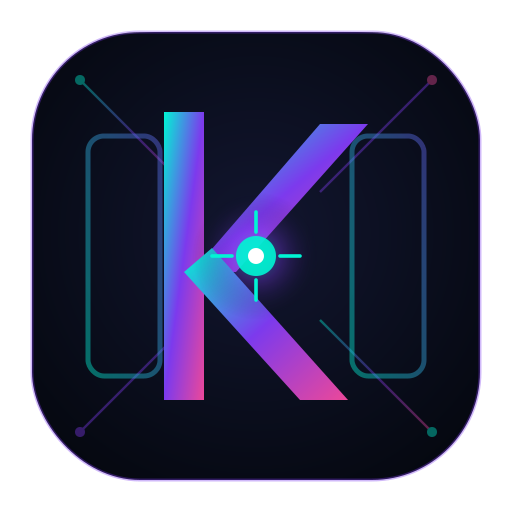
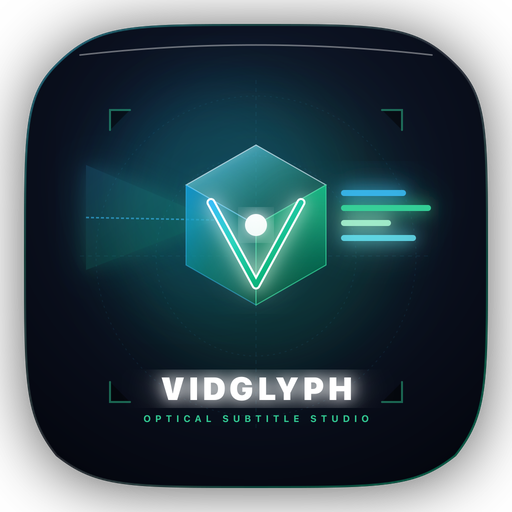

<!-- section:banner -->

  

  
  
  
  
  

<!-- end:banner -->

---

<!-- section:about -->
## 👨‍💻 About Me

<table width="100%" style="width:100%; border-collapse:collapse; margin-top:12px;">
  <tr>
    <td style="padding:22px 24px; background:#0d1117; border:1px solid #30363d; border-radius:12px;">
      

        ⚡ Full-Stack Developer &amp; Desktop / Audio-Video AI Architect
      

      

        专注跨平台高性能桌面应用与本地优先音视频 AI 工具链的开源工程实践。核心技术栈涵盖 <b>Rust · TypeScript · Python · C++</b>，深耕 <b>Tauri 2.0</b> 桌面工程体系、<b>Multi-Agent</b> 多智能体协作编排与音视频硬件加速。维护 <a href="https://github.com/Agions" style="color:#58a6ff; font-weight:600; text-decoration:none;">@Agions</a> 开源组织，打造涵盖 <b>AI 电影解说叙事 (Dramaxis)</b>、<b>AI 漫剧短剧全自动工坊 (Kineo)</b> 与 <b>硬字幕光学提取精编 (VidGlyph)</b> 的下一代开源视听生产力工具矩阵。
      

      

        <b>Core Domain:</b>
        <code style="background:#161b22; color:#79c0ff; border:1px solid #30363d; padding:3px 9px; border-radius:5px; font-size:11px;">Tauri 2.0 &amp; Rust</code>
        <code style="background:#161b22; color:#f5c842; border:1px solid #30363d; padding:3px 9px; border-radius:5px; font-size:11px;">Multi-Agent Architecture</code>
        <code style="background:#161b22; color:#00f5d4; border:1px solid #30363d; padding:3px 9px; border-radius:5px; font-size:11px;">Audio/Video AI Pipeline</code>
        <code style="background:#161b22; color:#a371f7; border:1px solid #30363d; padding:3px 9px; border-radius:5px; font-size:11px;">FFmpeg Hardware Acceleration</code>
        <code style="background:#161b22; color:#61dafb; border:1px solid #30363d; padding:3px 9px; border-radius:5px; font-size:11px;">React 19 &amp; Vue 3.5</code>
      

    </td>
  </tr>
</table>
<!-- end:about -->

---

<!-- section:projects -->
## 🚀 Featured Flagship Projects

<!-- Card 1: Dramaxis -->
<table width="100%" style="width:100%; border-collapse:collapse; margin-bottom:16px;">
  <tr>
    <td style="padding:20px 22px; background:#0d1117; border:1px solid #30363d; border-radius:12px;">
      

        <h3 style="margin:0; font-size:17px; font-weight:700;">
          <a href="https://github.com/Agions/dramaxis" style="color:#58a6ff; text-decoration:none;">Dramaxis</a> 剧枢 · 电影级解说创作平台
        </h3>
        ⭐ #1 Flagship &nbsp;·&nbsp; AI Film Narration
      

      
电影级多智能体影视叙事与智能解说创作平台 · 本地优先 · Tauri 2 · Rust · React 19 · 剪映/CapCut 互通

      

        
        
        
        
        
      

      

        ⚡ 6 大智能体编导群协同研磨 · 4 步工坊向导 · 5 轨毫秒级剪辑 · 剪映/CapCut 草稿深度互通 · 8 大平台消重发布矩阵，100% 本地端到端无损处理。
      

      

        

          <code style="background:#161b22; color:#79c0ff; border:1px solid #30363d; padding:2px 8px; border-radius:5px; font-size:11px;">Tauri 2.0</code>
          <code style="background:#161b22; color:#dea584; border:1px solid #30363d; padding:2px 8px; border-radius:5px; font-size:11px;">Rust</code>
          <code style="background:#161b22; color:#61dafb; border:1px solid #30363d; padding:2px 8px; border-radius:5px; font-size:11px;">React 19</code>
          <code style="background:#161b22; color:#f5c842; border:1px solid #30363d; padding:2px 8px; border-radius:5px; font-size:11px;">Multi-Agent</code>
          <code style="background:#161b22; color:#ff9500; border:1px solid #30363d; padding:2px 8px; border-radius:5px; font-size:11px;">Whisper</code>
          <code style="background:#161b22; color:#00f5d4; border:1px solid #30363d; padding:2px 8px; border-radius:5px; font-size:11px;">FFmpeg</code>
        

        

          <a href="https://agions.github.io/dramaxis/" style="color:#58a6ff; text-decoration:none; font-size:12.5px; font-weight:600; margin-right:14px;">📖 官方文档</a>
          <a href="https://github.com/Agions/dramaxis" style="color:#8b949e; text-decoration:none; font-size:12.5px; font-weight:500;">📂 源码仓库 →</a>
        

      

    </td>
  </tr>
</table>

<!-- Card 2: Kineo -->
<table width="100%" style="width:100%; border-collapse:collapse; margin-bottom:16px;">
  <tr>
    <td style="padding:20px 22px; background:#0d1117; border:1px solid #30363d; border-radius:12px;">
      

        <h3 style="margin:0; font-size:17px; font-weight:700;">
          <a href="https://github.com/Agions/kineo" style="color:#58a6ff; text-decoration:none;">Kineo</a> Kineo AI · 端到端多智能体漫剧
        </h3>
        🎨 AI Manga &amp; Anime Studio
      

      
端到端 AI 漫剧 / 动画短剧 Multi-Agent 多智能体协作创作平台 · Tauri 2 · Rust · React 19

      

        
        
        
        
        
      

      

        🎨 小说/剧本一键生成 4K 漫剧视频，采用 Hub-and-Spoke 智能体架构、ProjectBlackboard 共享黑板、分镜角色 Consistency 锚定与原生音视频合成。
      

      

        

          <code style="background:#161b22; color:#79c0ff; border:1px solid #30363d; padding:2px 8px; border-radius:5px; font-size:11px;">Tauri 2.0</code>
          <code style="background:#161b22; color:#dea584; border:1px solid #30363d; padding:2px 8px; border-radius:5px; font-size:11px;">Rust</code>
          <code style="background:#161b22; color:#61dafb; border:1px solid #30363d; padding:2px 8px; border-radius:5px; font-size:11px;">React 19</code>
          <code style="background:#161b22; color:#3178c6; border:1px solid #30363d; padding:2px 8px; border-radius:5px; font-size:11px;">TypeScript</code>
          <code style="background:#161b22; color:#a371f7; border:1px solid #30363d; padding:2px 8px; border-radius:5px; font-size:11px;">Hub-and-Spoke</code>
          <code style="background:#161b22; color:#00f5d4; border:1px solid #30363d; padding:2px 8px; border-radius:5px; font-size:11px;">FFmpeg</code>
        

        

          <a href="https://agions.github.io/kineo/" style="color:#58a6ff; text-decoration:none; font-size:12.5px; font-weight:600; margin-right:14px;">📖 官方文档</a>
          <a href="https://github.com/Agions/kineo" style="color:#8b949e; text-decoration:none; font-size:12.5px; font-weight:500;">📂 源码仓库 →</a>
        

      

    </td>
  </tr>
</table>

<!-- Card 3: VidGlyph -->
<table width="100%" style="width:100%; border-collapse:collapse; margin-bottom:16px;">
  <tr>
    <td style="padding:20px 22px; background:#0d1117; border:1px solid #30363d; border-radius:12px;">
      

        <h3 style="margin:0; font-size:17px; font-weight:700;">
          <a href="https://github.com/Agions/VidGlyph" style="color:#58a6ff; text-decoration:none;">VidGlyph</a> 字映 · 视频硬字幕光学精编
        </h3>
        🔍 Optical Subtitle Studio
      

      
本地优先的高性能视频硬字幕光学解析与多轨精编工坊 · Tauri 2 · Vue 3.5 · Rust · PaddleOCR

      

        
        
        
        
        
      

      

        🔍 毫秒级硬字幕区域智能检测、多语言 OCR 离线高精度提取引擎，支持多轨时间轴可视化校对与 SRT / ASS / VTT / LRC 多格式批量导出。
      

      

        

          <code style="background:#161b22; color:#79c0ff; border:1px solid #30363d; padding:2px 8px; border-radius:5px; font-size:11px;">Tauri 2.0</code>
          <code style="background:#161b22; color:#dea584; border:1px solid #30363d; padding:2px 8px; border-radius:5px; font-size:11px;">Rust</code>
          <code style="background:#161b22; color:#42b883; border:1px solid #30363d; padding:2px 8px; border-radius:5px; font-size:11px;">Vue 3.5</code>
          <code style="background:#161b22; color:#3178c6; border:1px solid #30363d; padding:2px 8px; border-radius:5px; font-size:11px;">TypeScript</code>
          <code style="background:#161b22; color:#f05138; border:1px solid #30363d; padding:2px 8px; border-radius:5px; font-size:11px;">PaddleOCR</code>
          <code style="background:#161b22; color:#00f5d4; border:1px solid #30363d; padding:2px 8px; border-radius:5px; font-size:11px;">FFmpeg</code>
        

        

          <a href="https://agions.github.io/VidGlyph/" style="color:#58a6ff; text-decoration:none; font-size:12.5px; font-weight:600; margin-right:14px;">📖 官方文档</a>
          <a href="https://github.com/Agions/VidGlyph" style="color:#8b949e; text-decoration:none; font-size:12.5px; font-weight:500;">📂 源码仓库 →</a>
        

      

    </td>
  </tr>
</table>
<!-- end:projects -->

---

<!-- section:activity -->
## 🌊 Contribution Activity

  <picture>
    <source media="(prefers-color-scheme: dark)" srcset="https://raw.githubusercontent.com/Agions/Agions/main/output/snake.svg" />
    
  </picture>

<!-- end:activity -->

---

<!-- section:contact -->
## 📬 Let's Connect

<table align="center" style="border-collapse:collapse; margin:16px auto;">
  <tr>
    <td align="center" style="padding:20px 30px; background:#0d1117; border:1px solid #30363d; border-radius:12px; box-shadow:0 8px 24px rgba(0,0,0,0.3);">
      
      
💬 微信公众号 · 开源合作与技术交流

      

        Email: <a href="mailto:agions@qq.com" style="color:#79c0ff; text-decoration:none;">agions@qq.com</a> &nbsp;·&nbsp;
        GitHub: <a href="https://github.com/Agions" style="color:#79c0ff; text-decoration:none;">@Agions</a>
      

    </td>
  </tr>
</table>
<!-- end:contact -->

---

<!-- section:footer -->

  ⚡ Agions · Building Next-Generation AI-Native Video &amp; Desktop Creative Toolchains · Since 2017

<!-- end:footer -->
